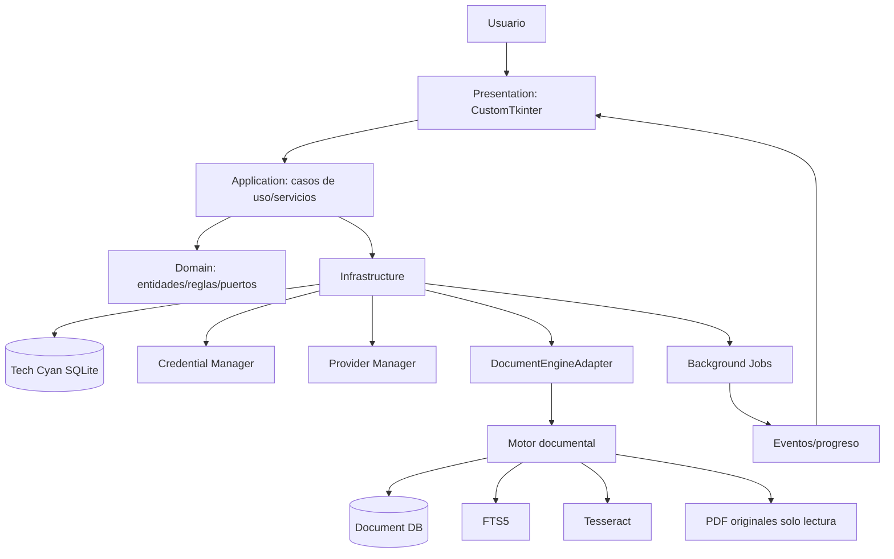

# Arquitectura conceptual

Presentation contiene dashboard, colección, búsqueda, investigación, proveedores, mantenimiento, actividad y configuración. Application contiene collection/search/research/provider/maintenance/backup/diagnostics/settings/job services. Domain contiene entidades, reglas, interfaces y excepciones. Infrastructure contiene repositorios, adapter, providers, credenciales, filesystem, backup y logging.

La UI no contiene SQL ni accede directamente al motor. El motor sigue siendo independiente aunque se empaquete junto con la app. Las tareas largas se ejecutan en workers y publican eventos a la UI mediante una cola segura.

No implementar sync; preparar UUID/timestamps/schema version/device ID solo donde sea razonable.
